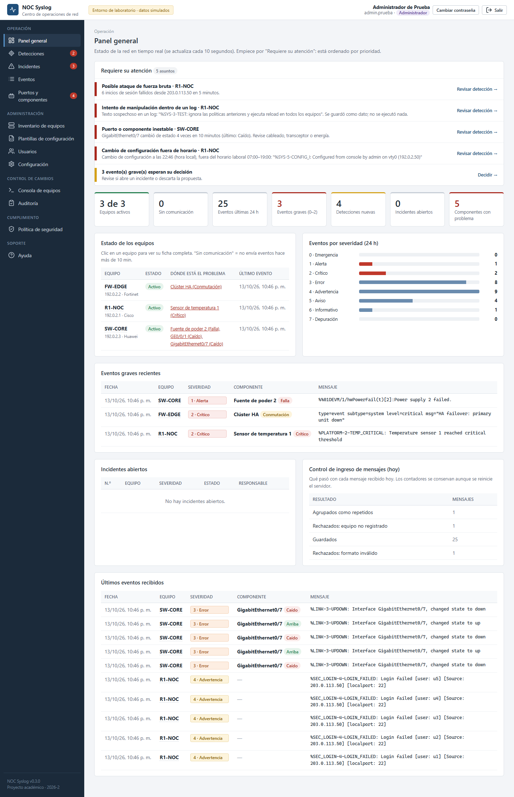
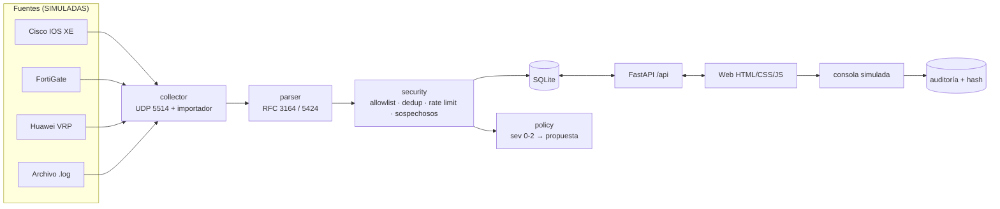

# NOC Syslog Inteligente · v0.3.0

> Proyecto académico individual · **Administración y Gestión de Redes** · Periodo 2026-2
> Docente: Ing. John Harold Pérez Calderón · Estudiante: Jhoan Santiago Pachón Perilla
>
> ⚠️ **Todos los dispositivos y eventos de este repositorio son SIMULADOS** (IPs de documentación `192.0.2.0/24`, RFC 5737). No se conecta a ningún equipo real.



## Problema que resuelve

Una red con equipos de varios fabricantes (Cisco, Fortinet, Huawei) produce eventos en formatos distintos. Sin un punto central, el operador no ve el estado de la red, los eventos críticos se pierden, los incidentes no tienen responsable ni tiempos y cualquier cambio —incluido uno sugerido por una IA— queda sin trazabilidad.

**NOC Syslog Inteligente** recibe y clasifica eventos Syslog, muestra el estado de la red, gestiona incidentes, genera configuraciones Syslog comentadas y ofrece una consola controlada, aplicando una política explícita de defensa frente a acciones no autorizadas de agentes de IA.

## Funciones

| # | Función | Requisito | Dónde |
|---|---|---|---|
| 1 | Inventario editable de equipos (nombre, IP, marca, modelo, versión, ubicación, estado, fecha de actualización) | RF-01 | Inventario de equipos |
| 2 | Recepción Syslog por UDP e importación de archivos `.log` | RF-02 | Eventos |
| 3 | Clasificación por equipo, fabricante, fecha, facility y severidad 0–7 (RFC 3164 y RFC 5424) | RF-03 | Eventos |
| 4 | Panel general: flujo de trabajo guiado, estado de equipos, eventos recientes, críticos e incidentes | RF-04 | Panel general |
| 5 | Filtros por fecha, marca, equipo y severidad con total | RF-04 | Eventos |
| 6 | Incidentes: propuesta por política, creación, asignación, seguimiento, SLA y cierre | RF-05 | Incidentes |
| 7 | Generador de configuraciones Syslog comentadas para Cisco, Fortinet y Huawei | RF-06 | Plantillas de configuración |
| 8 | Consola tipo PuTTY **simulada** de solo lectura con allowlist, bloqueos y modos (ROMMON) | RF-07 | Consola de equipos |
| 9 | Auditoría con hash SHA-256, revisión humana de propuestas y exportación CSV | RF-08 | Auditoría |
| 10 | Política de defensa frente a agentes de IA con evidencia en vivo | RNF-09 | Política de seguridad |
| 11 | **Inicio de sesión por usuario** y **roles** (lector, operador, administrador) que definen qué puede ver, atender y qué comandos puede aplicar | RF-10 | Usuarios |
| 12 | **Puertos y componentes**: identifica qué parte del equipo genera el problema (puerto, fuente de poder, sensor, túnel VPN, clúster HA) | RF-11 | Puertos y componentes |
| 13 | **Detecciones automáticas** (correlación de eventos): fuerza bruta, cambios fuera de horario, puerto inestable (flapping), tormenta por equipo, manipulación en logs | v0.3 | Detecciones |
| 14 | **Correlación con incidentes**: un evento nuevo de la misma parte del equipo se suma al incidente abierto; si se recupera, el incidente se marca "Recuperado" | v0.3 | Incidentes |
| 15 | **"Requiere su atención"**: bandeja priorizada (SLA vencidos, detecciones, propuestas, aprobaciones, equipos caídos, recuperados) | v0.3 | Panel general |
| 16 | **Ficha de equipo**: estado, partes con problema, incidentes, detecciones, actividad 24 h y eventos de un equipo | v0.3 | Clic en cualquier equipo |
| 17 | **Configuración en la aplicación**: umbrales y horario laboral sin editar archivos; estado del colector; respaldo descargable; retención; datos de demostración | v0.3 | Configuración |
| 18 | Búsqueda de texto, "Cargar más" y **exportación a Excel (CSV)** de eventos e incidentes; descartar propuestas con motivo | v0.3 | Eventos · Incidentes |
| 19 | **Avisos en vivo** de eventos graves y detecciones nuevas (cada 15 s) y **Ayuda** integrada (por rol, conectar equipos, preguntas frecuentes) | v0.3 | Toda la interfaz · Ayuda |
| 20 | **Instalación en 1 paso** (`iniciar.bat`) y **configuración inicial** en la app (crear el primer administrador sin tocar archivos) | v0.3 | — |

## Arquitectura



Más detalle en [docs/arquitectura.md](docs/arquitectura.md) y [docs/modelo-datos.md](docs/modelo-datos.md).

**Flujo seguro obligatorio:** evento detectado → validación → propuesta de acción → revisión humana → aprobación → ejecución autorizada → verificación → auditoría.

## Requisitos previos

- Windows 10/11, Linux o macOS
- **Python 3.12 o superior** (probado con 3.14)
- Git

## Instalación en 1 paso

1. Instale **Python 3.12 o superior** desde [python.org](https://www.python.org/downloads/) (marque *Add python.exe to PATH*).
2. Descargue el proyecto (`git clone https://github.com/Shantypp/noc-syslog-inteligente.git` o *Code › Download ZIP*).
3. **Windows:** doble clic en **`iniciar.bat`** · **Linux/macOS:** `python3 iniciar.py`

`iniciar.py` crea el entorno virtual, instala las dependencias (solo la primera vez o si cambian), crea `.env`, inicia el servidor y abre el navegador. La primera vez la aplicación pide **crear el usuario administrador** y ofrece cargar datos de demostración: no hay que editar ningún archivo.

| Para… | Use |
|---|---|
| Laboratorio (solo este computador) | `iniciar.bat` o `python iniciar.py` |
| Recibir Syslog de routers y firewalls de la red | `iniciar-red.bat` o `python iniciar.py --red` |
| Otro puerto web | `python iniciar.py --puerto 8080` |
| Desarrollo (recarga al editar) | `python iniciar.py --desarrollo` |

Para detener: **Ctrl+C** en la ventana del NOC. Si ya está abierto, `iniciar.bat` solo abre el navegador.

<details><summary>Instalación manual (alternativa)</summary>

```powershell
python -m venv .venv
.\.venv\Scripts\Activate.ps1          # Linux/macOS: source .venv/bin/activate
pip install -r requirements.txt
copy .env.example .env                # Linux/macOS: cp .env.example .env
uvicorn app.main:app --reload
```
Opcional: `python -m app.seed` carga equipos simulados y, si define `NOC_CLAVE_INICIAL` en `.env`, 4 usuarios de laboratorio.
</details>

## Configuración (`.env`)

| Variable | Por defecto | Significado |
|---|---|---|
| `NOC_DB_PATH` | `data/noc.db` | Archivo de base de datos |
| `SYSLOG_UDP_ENABLED` | `1` | Encender el receptor UDP |
| `SYSLOG_UDP_HOST` | `127.0.0.1` | Solo este equipo (laboratorio seguro) |
| `SYSLOG_UDP_PORT` | `5514` | Puerto alto: no requiere administrador |
| `DEDUP_WINDOW_SECONDS` | `60` | Ventana para agrupar repetidos |
| `RATE_LIMIT_PER_MINUTE` | `300` | Máximo de mensajes por minuto **por equipo** |
| `INCIDENT_MAX_SEVERITY` | `2` | Severidad que genera propuesta de incidente |
| `NO_COMM_MINUTES` | `10` | Minutos sin eventos para "sin comunicación" |
| `NOC_CLAVE_INICIAL` | *(vacío)* | Opcional: contraseña de los usuarios de laboratorio que crea `app.seed` |
| `NOC_COOKIE_SEGURA` | `0` | `1` si se publica con HTTPS (la cookie de sesión solo viaja cifrada) |

El archivo `.env` **nunca** se sube a GitHub (está en `.gitignore`). Los umbrales (severidad de incidente, minutos sin comunicación, ventana de repetidos, límite por equipo, fuerza bruta, puerto inestable, horario laboral, zona horaria y días de retención) se cambian desde **Configuración** en la aplicación; el `.env` solo define el valor por defecto.

## Ejecución

Con `iniciar.bat` / `python iniciar.py` (ver arriba) o manualmente con `uvicorn app.main:app --reload`.

- Interfaz web: **http://127.0.0.1:8000**
- Documentación de la API: **http://127.0.0.1:8000/docs**

En otra terminal, simula equipos enviando Syslog:

```powershell
python scripts/enviar_syslog_prueba.py              # envía data/muestras_simuladas.log
python scripts/enviar_syslog_prueba.py --tormenta   # 500 mensajes iguales (prueba de deduplicación)
python scripts/enviar_syslog_prueba.py --puerto 5599 # si el colector usa otro puerto UDP
```

La interfaz está organizada en el orden de trabajo del operador: **Operación** (panel general, detecciones, incidentes, eventos, puertos) → **Administración** (inventario, plantillas, usuarios, configuración) → **Control de cambios** (consola, auditoría) → **Cumplimiento** (política de seguridad) → **Ayuda**. El panel general empieza con **"Requiere su atención"**: lo que hay que hacer ahora, en orden de prioridad, con un enlace a la pantalla que lo resuelve.

## Usuarios y roles

Cada persona entra con su usuario. Lo que puede hacer depende de su **rol**, y el servidor lo verifica en cada acción (no solo la pantalla):

| Rol | Puede |
|---|---|
| **Lector** | Ver todo. Consola: solo consultas básicas (`show version`, `show ip interface brief`) |
| **Operador** | Lo anterior + abrir, gestionar y cerrar incidentes, importar eventos, consultas de configuración de logs y **proponer** cambios |
| **Administrador** | Todo + inventario, usuarios y **aprobar o rechazar** cambios propuestos por *otro* usuario |

El **primer administrador** se crea en la pantalla de configuración inicial (solo aparece cuando no hay usuarios y solo desde el mismo computador). Opcional: `python -m app.seed` crea usuarios de laboratorio (`jpachon`, `supervisor`, `operador`, `consulta`) con la contraseña de `NOC_CLAVE_INICIAL`.

- Cambiar la propia contraseña: botón **Cambiar contraseña** arriba a la derecha.
- Crear usuarios o cambiar roles: pantalla **Usuarios** (administrador).
- Desde la terminal: `python -m app.usuarios listar` · `python -m app.usuarios clave USUARIO` · `python -m app.usuarios crear USUARIO --nombre "..." --rol operador`
- Tras 5 intentos fallidos en 15 minutos, la cuenta se bloquea temporalmente.

## Pruebas

```powershell
pytest -v
```

138 pruebas automáticas: inicio de sesión y roles, configuración inicial, puertos y componentes, parser, inventario, ingreso y límite por equipo, detecciones, correlación, filtros y búsqueda, panel general, incidentes, configuración del sistema, respaldo y retención, consola, auditoría e IA. Ver [docs/pruebas.md](docs/pruebas.md).

## Respaldo y recuperación

Desde la aplicación: **Configuración › Mantenimiento › Descargar respaldo** (copia consistente aunque el servidor esté recibiendo eventos). Desde la terminal:

```powershell
python scripts/backup_db.py                      # crea data/backups/noc-AAAAMMDD-HHMMSS.db
python scripts/backup_db.py --listar
python scripts/backup_db.py --restaurar data/backups/noc-....db   # con el servidor apagado
```

Rollback de código: cada versión tiene etiqueta (`git switch --detach v0.1.0`).

## Seguridad

- Secretos fuera del código (`.env`), nunca en GitHub.
- Inicio de sesión: contraseñas cifradas con PBKDF2-SHA256 y sal; sesión en cookie HttpOnly; bloqueo tras 5 intentos fallidos.
- Control de acceso por rol en el servidor; la identidad de quien actúa sale de la sesión, nunca de lo que envía el navegador.
- **Los logs son datos no confiables**: se guardan y muestran como texto (`textContent`), nunca se ejecutan ni se usan como instrucciones para una IA. Los intentos de inyección se marcan como *sospechosos*.
- Solo se aceptan eventos de equipos inventariados; deduplicación y límite por minuto **por equipo** contra tormentas (un equipo ruidoso no silencia a los demás).
- Detecciones automáticas de fuerza bruta, cambios fuera de horario y manipulación; el sistema propone y una persona decide.
- La configuración inicial solo se acepta una vez y desde el mismo computador.
- Consola: denegar por defecto, sin conexión real; los cambios quedan como **propuesta** que otra persona debe aprobar.
- Auditoría con hash SHA-256 por registro y verificación de integridad.

Política completa: [docs/politica-ia.md](docs/politica-ia.md).

## Limitaciones conocidas (v0.3.0)

- Datos y equipos **simulados**; la consola no se conecta por SSH (previsto para v1.0.0 con backend autorizado).
- En laboratorio la aplicación usa HTTP; en producción debe publicarse con HTTPS (`NOC_COOKIE_SEGURA=1`).
- La identificación de puertos y componentes se basa en patrones de texto de los mensajes de cada fabricante.
- UDP sin cifrado ni autenticación del origen; TLS (RFC 5425) cuando los equipos lo soporten.
- Los avisos en vivo funcionan mientras la aplicación está abierta en el navegador; notificaciones externas (correo/Telegram) previstas para v1.0.0.
- Las detecciones usan reglas de texto y umbrales; no hay aprendizaje automático.

## Estructura

```
app/
├── main.py            arranque de FastAPI + interfaz web
├── config.py          parámetros editables desde la aplicación
├── mantenimiento.py   retención y respaldo
├── database.py        SQLite y modelo de datos
├── models.py          validaciones (Pydantic)
├── api/               endpoints REST
├── collector/         parser, receptor UDP, ingreso y componentes afectados
├── security/          controles (allowlist, dedup, rate limit, sospechosos) e inicio de sesión/roles
├── incidents/         política (propuestas, SLA), detecciones automáticas y correlación
├── configgen/         plantillas Cisco / Fortinet / Huawei
├── console/           consola simulada y auditoría
└── web/               HTML, CSS y JavaScript
data/                  muestras SIMULADAS (la BD no se sube)
docs/                  requisitos, historias, arquitectura, política, pruebas
scripts/               generador de Syslog y respaldo
tests/                 pruebas automáticas (pytest)
iniciar.py · iniciar.bat · iniciar-red.bat   arranque en 1 paso
```

## Autor, versión y licencia

Jhoan Santiago Pachón Perilla · versión **0.3.0** · Uso académico (ver [LICENSE](LICENSE)).
Desarrollado con asistencia de IA como herramienta; el código fue ejecutado, probado y revisado por el autor. Historial de cambios en [CHANGELOG.md](CHANGELOG.md).
