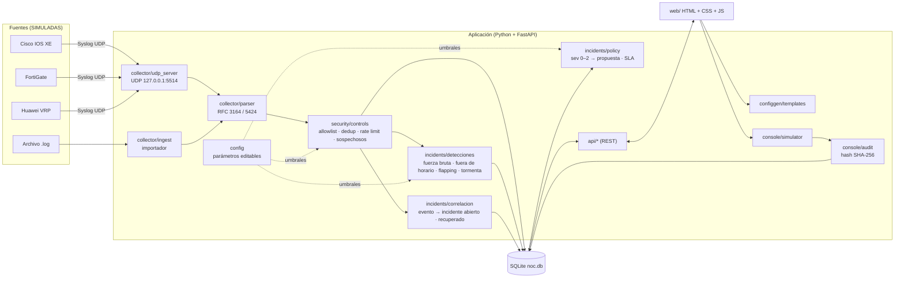
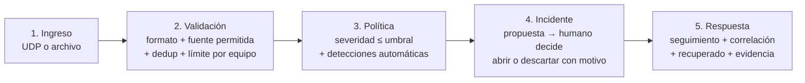
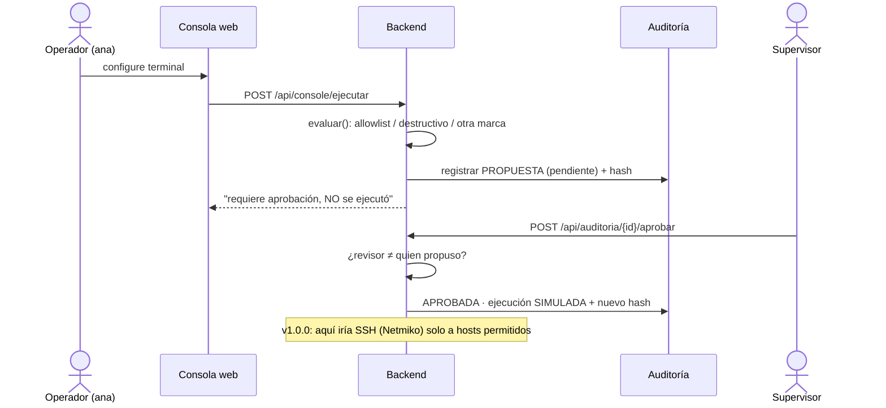

# Arquitectura

## Componentes

## Flujo lógico del curso

Además de la severidad de cada evento, el paso 3 mira **varios eventos juntos** (`incidents/detecciones.py`): fuerza bruta por IP de origen, cambios de configuración fuera del horario laboral, puertos inestables, tormentas por equipo y manipulación en logs. En el paso 5, cada evento nuevo de una parte del equipo que ya tiene incidente abierto se agrega a su historial (`incidents/correlacion.py`) y, si esa parte vuelve a "Arriba", el incidente se marca *Recuperado*. Los umbrales se leen de `app/config.py` (editables en la pantalla Configuración).

## Flujo seguro de acciones

## Decisiones (ADR)

| ADR | Decisión | Motivo |
|---|---|---|
| 001 | Python + FastAPI + SQLite + HTML/JS sin frameworks | Simple de instalar y explicar; `/docs` permite probar la API; Netmiko (SSH, Corte 3) es Python |
| 002 | Los logs son datos no confiables | Evita inyección de prompt indirecta y XSS |
| 003 | La política propone, el humano decide | Flujo seguro obligatorio; evita escalada autónoma |
| 004 | Receptor en 127.0.0.1:5514 por defecto | Laboratorio seguro sin permisos de administrador |
| 005 | Validación de comandos en el backend | En el navegador se puede saltar con F12 |
| 006 | Identidad desde la sesión (cookie HttpOnly) y permisos por rol en el servidor | Un nombre escrito en pantalla se puede falsificar |
| 007 | Componente afectado por reglas de texto por fabricante | Sin acceso a los equipos, el log es la única fuente; se limita a caracteres seguros |
